<p align="center">
  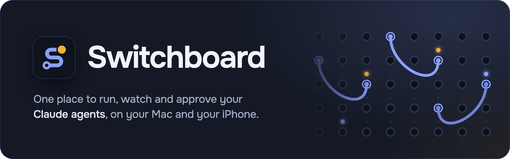
</p>

<p align="center">
  A local control center that runs on your Mac with your own Claude Code login.<br>
  Every command, edit and web request of an agent waits for your answer.
</p>

<p align="center">
  
  
  
  
  
</p>

<p align="center">
  <a href="#install-the-mac-app">Download for Mac</a> ·
  <a href="#quick-start">Quick start</a> ·
  <a href="#how-it-works">How it works</a> ·
  <a href="#security-model">Security model</a> ·
  <a href="#approvals">Approvals</a> ·
  <a href="apple/README.md">Native apps</a>
</p>

<p align="center">
  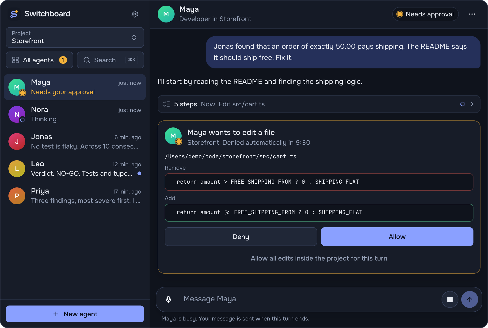
</p>

## What it does

You give Switchboard a list of project folders. In each project you create agents, give each one a name and a role, and talk to them like colleagues in a chat. Every agent is a real Claude Code session that works in the project folder.

- **Projects.** Each project is a folder on your Mac. Switch between them, each keeps its own agents and its own context.
- **Agents with roles.** Seven roles come with the repo: Developer, Tester, Reviewer, Ideation, Deploy check, Tutor and Social media. A role sets the prompt and the tools an agent may use at all. Add your own in `roles.json`.
- **One board for everything.** All agents across all projects with their live status and what they are doing right now.
- **Approvals on every device.** An agent cannot run a command, change a file or go online until you allow that exact action. The request shows up on the Mac and on the phone, and the first answer wins.
- **Keep typing.** Messages you send while an agent works are queued and go out when the turn ends.
- **Dictation.** Speak a message with the microphone button.
- **Restart safe.** Agents and their history live in a local database, and an agent resumes its session after the host restarts.
- **Three ways in.** A web app you can install, a Mac app with a menu bar item, and an iPhone app. All three talk to the same host and stay in sync.

## Install the Mac app

The easiest way in. The app brings its own host, so you need no clone, Node or pnpm.

1. Download [Switchboard-2.1.0-arm64.dmg](https://github.com/platret/switchboard/releases/download/v2.1.0/Switchboard-2.1.0-arm64.dmg) (193 MB) from the [v2.1.0 release](https://github.com/platret/switchboard/releases/tag/v2.1.0). It needs a Mac with Apple silicon and macOS 14 or later.
2. Open it and drag Switchboard into Applications.
3. The app is not notarized, so macOS stops the first launch. Right-click Switchboard and choose **Open**, or go to **System Settings → Privacy & Security → Open Anyway**.

A short setup then checks your Mac (Claude Code sign-in, the Claude app, Tailscale, notifications), lets you choose project folders and roles, starts the host and pairs your iPhone with a QR code. Settings, the token and history stay in `~/Library/Application Support/Switchboard`. To run setup again, use **Switchboard → Set Up Switchboard…**.

The SHA-256 of the disk image is in the release notes.

## Quick start

To run Switchboard from source instead, you need a Mac with Node 22.12 or newer, pnpm (`npm install -g pnpm`) and Claude Code installed and logged in, so that `claude` works in your terminal.

```bash
git clone https://github.com/platret/switchboard.git
cd switchboard
pnpm install
pnpm dev
```

The first start creates two private files in the repo folder: `.env` with a random access token, and `projects.json` as a copy of `projects.example.json`.

1. Open `projects.json` and point at least one entry at a folder that exists on your Mac. The host restarts by itself when you save. Until then the app has no project, because the example folders do not exist on your machine.
2. Open http://127.0.0.1:4317.
3. Paste the access token. The app asks for it once per browser. `pnpm dev` keeps running in the first terminal, so open a second one in the repo folder and print the token with:

   ```bash
   sed -n 's/^SWITCHBOARD_TOKEN=//p' .env
   ```

4. Choose New agent, pick a role, give it a name and send the first message.

`pnpm dev` restarts the host when `projects.json`, `roles.json` or `.env` change and rebuilds the web app when its code changes. To run it without watching, use `pnpm start`.

## Requirements

- The Mac app: Apple silicon and macOS 14 or later. From source: macOS with Node 22.12 or newer and pnpm.
- Claude Code installed and logged in. Agents use that login. `ANTHROPIC_API_KEY` and `ANTHROPIC_AUTH_TOKEN` from your shell are not passed on to them.
- Tailscale on the Mac and on the iPhone, signed in to the same account. Only needed for phone access.
- Xcode 26 and XcodeGen. Only needed for the native apps, see [apple/README.md](apple/README.md).

## Screenshots

<p align="center">
  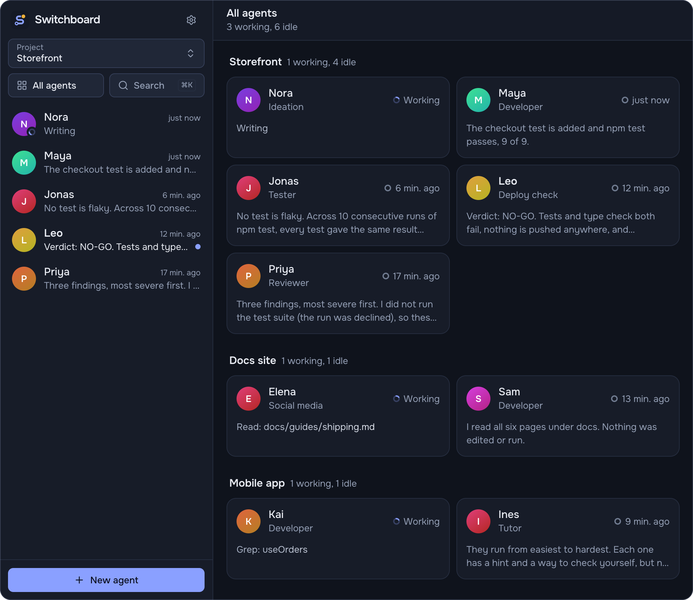<br>
  <sub>Every agent in every project, three of them working</sub>
</p>

<p align="center">
  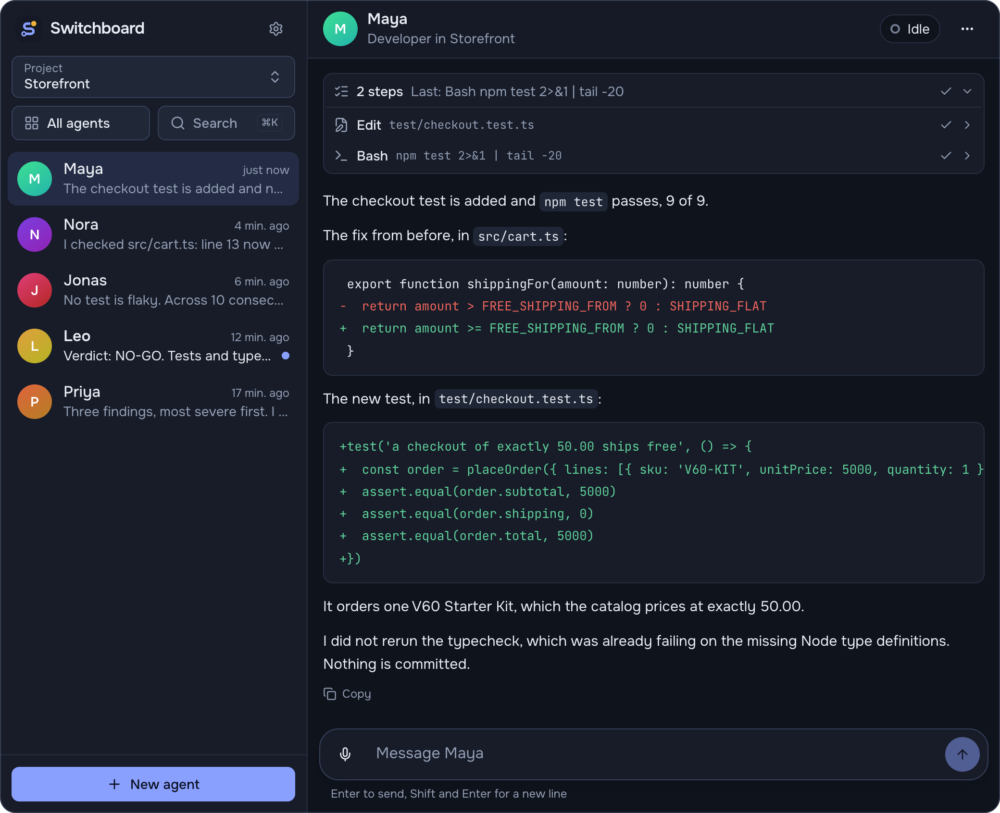<br>
  <sub>A finished turn: tool steps, markdown and diffs</sub>
</p>

<details>
<summary>More of the web app: Command K and the light theme</summary>
<br>
<p align="center">
  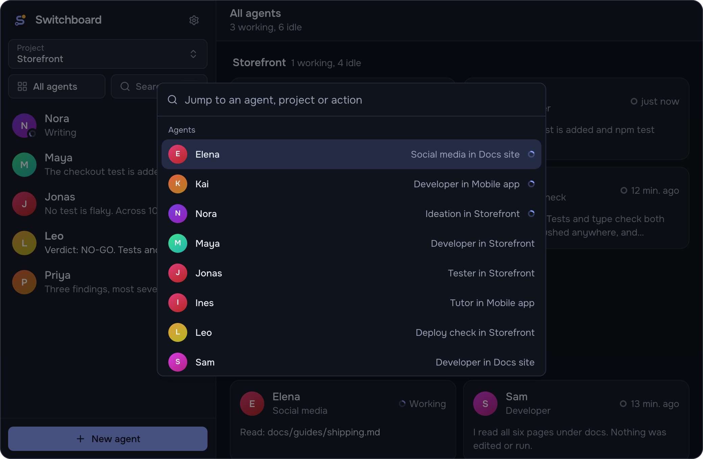<br>
  <sub>Command K jumps to any agent, project or action</sub>
</p>
<p align="center">
  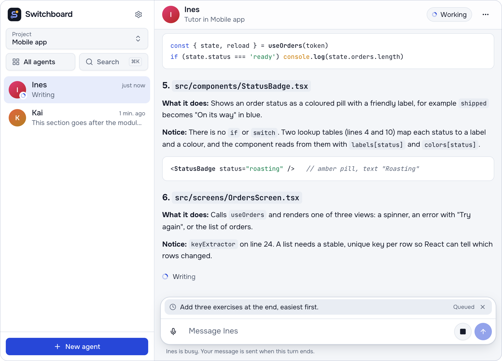<br>
  <sub>Light theme, mid answer, with one message queued</sub>
</p>
</details>

The web app on an iPhone:

<table>
  <tr>
    <td width="33%">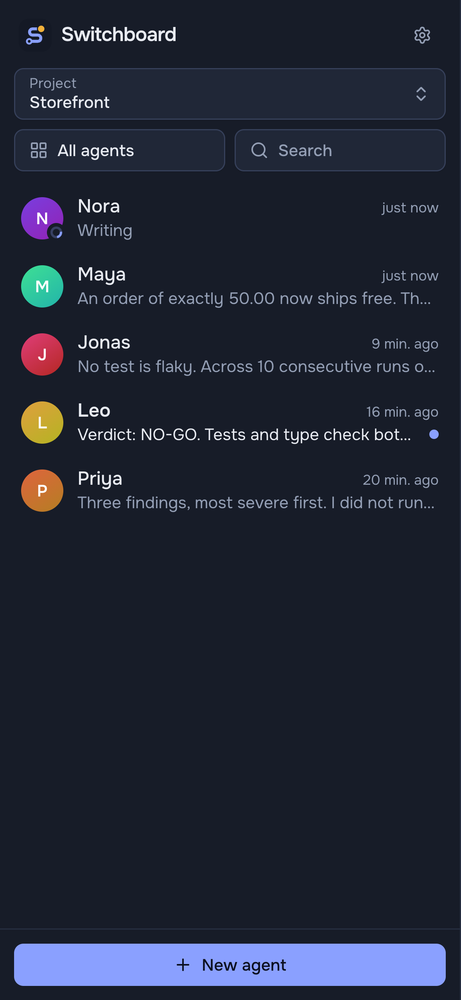</td>
    <td width="33%">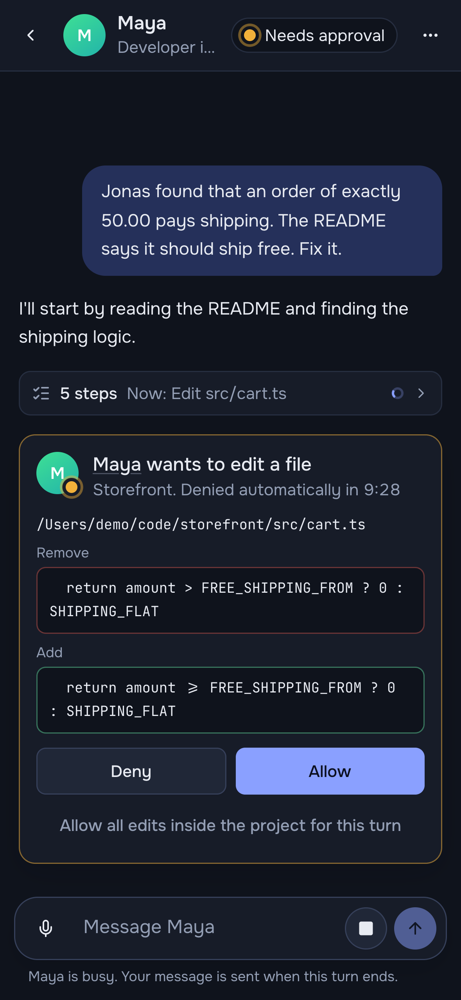</td>
    <td width="33%">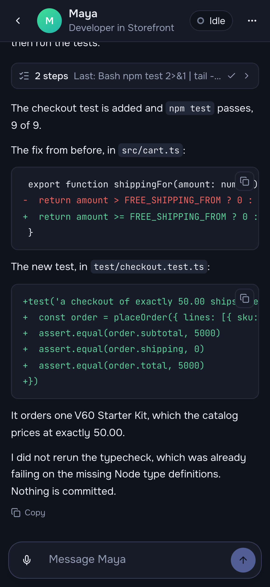</td>
  </tr>
  <tr>
    <td align="center"><sub>Agents of a project</sub></td>
    <td align="center"><sub>Approve an edit from the phone</sub></td>
    <td align="center"><sub>Read the result</sub></td>
  </tr>
</table>

The native iPhone app:

<table>
  <tr>
    <td width="33%">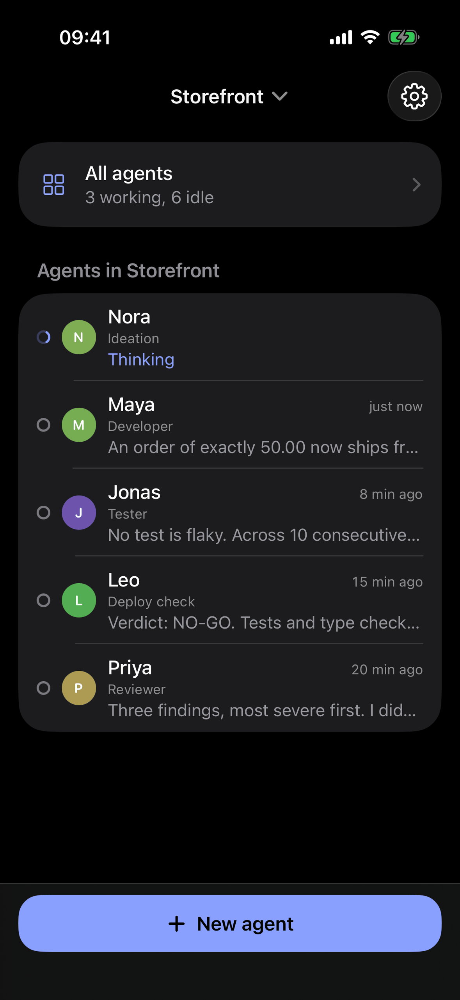</td>
    <td width="33%">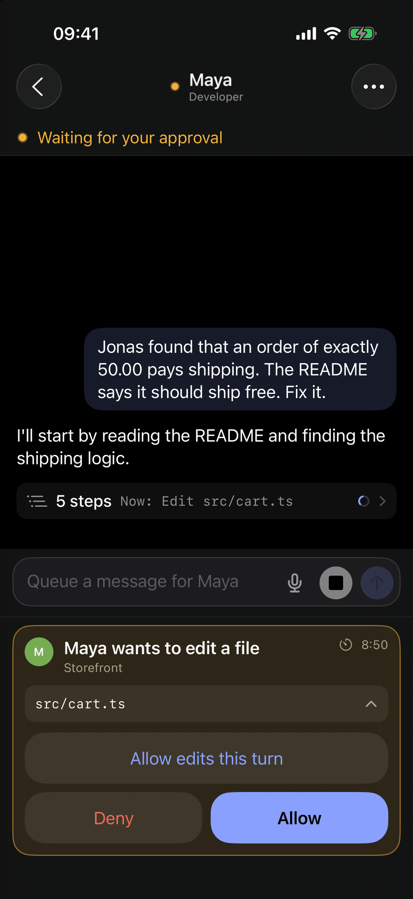</td>
    <td width="33%">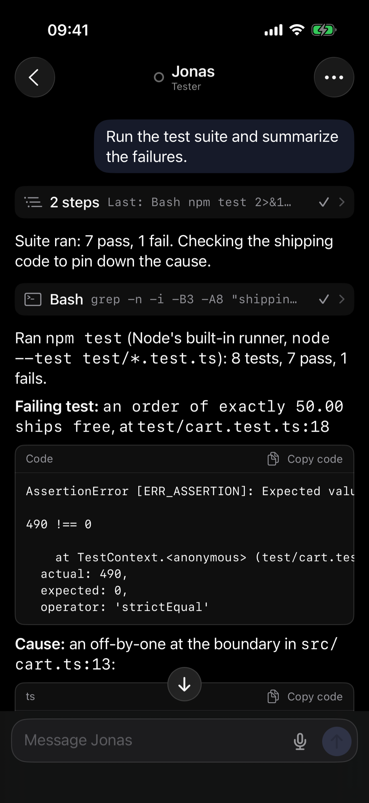</td>
  </tr>
  <tr>
    <td align="center"><sub>Home with status lamps</sub></td>
    <td align="center"><sub>The approvals tray</sub></td>
    <td align="center"><sub>Chat with tool steps and code blocks</sub></td>
  </tr>
</table>

All screenshots show demo projects with made-up agents.

## How it works

One process on your Mac, the host, does all the work. The web app, the Mac app and the iPhone app are thin clients that show what the host knows and send it your answers.

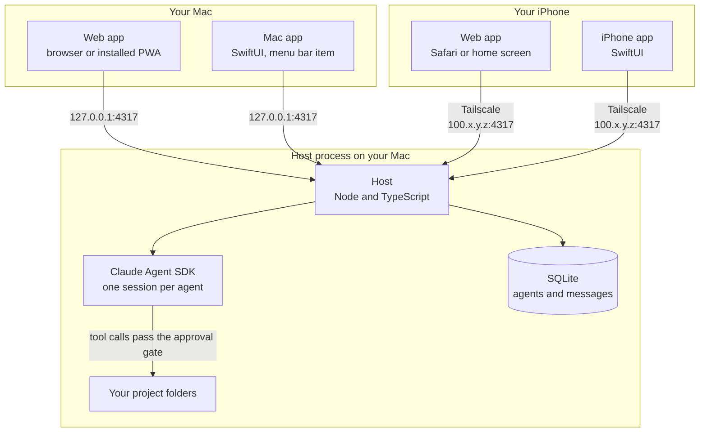

| Part | What it does |
|---|---|
| `host/` | Node and TypeScript. Runs one Claude Agent SDK session per agent, stores agents and messages in SQLite, serves the REST API, the WebSocket and the built web app. |
| `web/` | React, Vite, Tailwind and shadcn/ui. One responsive app, installable as a PWA. |
| `shared/` | Types and zod schemas for REST and WebSocket messages, used by the host and the web app. |
| `apple/` | One SwiftUI codebase for the Mac app and the iPhone app. Both speak the same API as the web app. |

Clients create, rename and delete agents over REST. Everything else travels over one WebSocket per client: the full state when it connects, then chat text as it streams, status changes, approval requests and their answers.

Before a tool runs, the call passes a gate in the host:

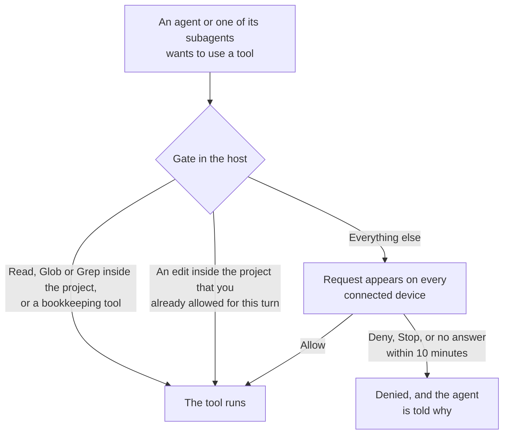

The exact rules are under [Approvals](#approvals).

## Security model

Switchboard is built for one person on their own devices.

- **Where it listens.** The host binds to `127.0.0.1` and to the Tailscale address of the Mac, and to nothing else. It is not reachable from your Wi-Fi or from the internet. Without Tailscale it listens on the Mac only.
- **Token on every request.** Every REST call needs `Authorization: Bearer` with the access token. A WebSocket has to send the token as its first message and is closed after 5 seconds without one. The host creates the token on the first start, 32 random bytes, and stores it in `.env` with file mode 600. Only the static files of the web app are served without a token, and they hold no data.
- **Agents never bypass permissions.** Agents always run in permission mode `default`. Bypass mode and auto mode are switched off for them, deny rules from your Claude Code settings still apply, and every tool call passes the approval gate.
- **Agents cannot read the token.** All `SWITCHBOARD_` variables are removed from the environment of an agent. Reading Switchboard's own `.env` and data folder is blocked for agents, even when the repo lies inside a project folder. A shell command that tries it needs your approval like any other command.
- **Transport.** The host speaks plain HTTP. On the Mac that stays on the loopback interface. Between phone and Mac it travels inside the tunnel that Tailscale encrypts. The web app keeps the token in the browser's local storage, the iPhone app keeps it in the Keychain.

Anyone who has the token and can reach the host can do what you can do in the app, so treat the token and the pairing QR code like a password.

## Settings

All settings live in `.env`. The host creates that file by itself, so copying `.env.example` is optional. The example holds the common settings, this table lists all of them.

| Variable | Default | Meaning |
|---|---|---|
| `SWITCHBOARD_TOKEN` | created on first start | Access token for the apps and the API. At least 24 characters. |
| `SWITCHBOARD_PORT` | `4317` | Port for HTTP and WebSocket |
| `SWITCHBOARD_SETTING_SOURCES` | `user,project,local` | Which Claude Code settings agents load. `project` loads the project folder's `CLAUDE.md` and `.claude/`. `user` adds your global `~/.claude` plugins, hooks, skills and MCP servers. |
| `SWITCHBOARD_APPROVAL_TIMEOUT_SECONDS` | `600` | Seconds until an unanswered approval is denied. 600 is also the maximum. |
| `SWITCHBOARD_DATA_DIR` | `data.nosync` in the repo, or `data` in `SWITCHBOARD_HOME` | Folder for the database. Use an absolute path or one that starts with `~`. |
| `SWITCHBOARD_TAILSCALE_IP` | detected | Set it if the Tailscale address is not found automatically. Only addresses in 100.64.0.0/10 are accepted. `off` listens on 127.0.0.1 only, which is what test runs should use. |
| `SWITCHBOARD_CLAUDE_PATH` | the Agent SDK's own | Path to the `claude` executable agents run. Must be an existing executable file. Use an absolute path or one that starts with `~`. |

A relative path in `SWITCHBOARD_DATA_DIR` or `SWITCHBOARD_CLAUDE_PATH` is resolved against the folder the host was started in, which is `host/` under `pnpm` and the settings folder in the Mac app, so the same line means different places.

To change the token, edit the value in `.env` and restart the host. Browsers and the iPhone app then ask for the new one.

With `user` in the setting sources, every agent starts with all your global plugins and hooks. That is convenient, but it makes turns slower and each agent heavier. Use `SWITCHBOARD_SETTING_SOURCES=project,local` for lean agents.

### Settings folder outside the repo

By default the host keeps its writable files in the repo: `.env`, `projects.json` and `data.nosync/`. Set `SWITCHBOARD_HOME` in the shell environment (not in `.env`, which lives inside it) to keep them in another folder instead:

```sh
SWITCHBOARD_HOME=~/Library/Application\ Support/Switchboard pnpm start
```

That folder then holds `.env`, `projects.json` (created empty), an optional `roles.json` that replaces the repo's one, and the database in `data/`. The host creates the folder with access for your user only. The web app and the default roles still come from the repo. Agents cannot read that folder, and changes there always need your approval. The packaged Mac app uses `~/Library/Application Support/Switchboard`.

`pnpm dev` only watches the repo's `projects.json`, `roles.json` and `.env`. With `SWITCHBOARD_HOME` set, restart the host yourself after you edit the files in that folder.

## Add a project

Edit `projects.json` in the repo root and restart the host. `pnpm dev` restarts by itself when the file changes. The file is your private configuration and is not tracked by git. It is a list of entries like this one, and `projects.example.json` shows a full list:

```json
{
  "id": "sideproject",
  "name": "Side project",
  "path": "~/code/sideproject",
  "additionalDirectories": ["~/code/shared-lib"],
  "agents": ["dev", "tester", "reviewer"]
}
```

- `id` must be unique. Agents remember their project by this id, so do not change it later.
- `path` is the working folder of every agent in the project. Its `CLAUDE.md` and `.claude/agents/` are loaded from here. `~` stands for your home folder.
- `additionalDirectories` is optional. Agents may read there without asking.
- Every folder of an entry has to exist. Otherwise the host skips that project and names the missing folder in its log.
- `agents` lists the role ids you can pick when you create an agent in this project. An id that is not in `roles.json` stops the host with a message that names it.

## Add a role

Edit `roles.json` in the repo root and restart the host.

```json
{
  "id": "docs",
  "name": "Docs writer",
  "description": "Keeps the README and docs in sync with the code.",
  "systemPrompt": "You are a documentation agent. You keep the README and docs in sync with the code.",
  "tools": ["Read", "Glob", "Grep", "Edit", "Write"],
  "model": "claude-sonnet-5-5",
  "starters": ["Which docs are out of date?", "Document the last change."]
}
```

- `description` is the line shown in the role picker and in an empty chat.
- `starters` are the suggestions shown in an empty chat. Optional.
- `model` is optional. Without it the agent uses your Claude Code default model.
- `systemPrompt` is appended to the Claude Code system prompt.
- `tools` is the set of built-in tools the role can use at all. It does not approve anything. Approvals are decided separately, see below.
- Add the role id to the `agents` list of each project that should offer it.
- A changed role applies to every agent of that role from its next message after the host restarts. The conversation so far stays.

## Approvals

Every tool call of every agent, including subagents, passes a gate in the host before it runs.

- Read, Glob and Grep inside the project folders run without asking.
- Bookkeeping tools without side effects run without asking: TodoWrite, ToolSearch, Skill, Agent and the task list tools. The list is in `host/src/agents/policy.ts`. A subagent that asks for an isolated worktree still needs your approval.
- Everything else waits for you: commands, edits, writes, web access, MCP tools, and reads outside the project folders.

<p align="center">
  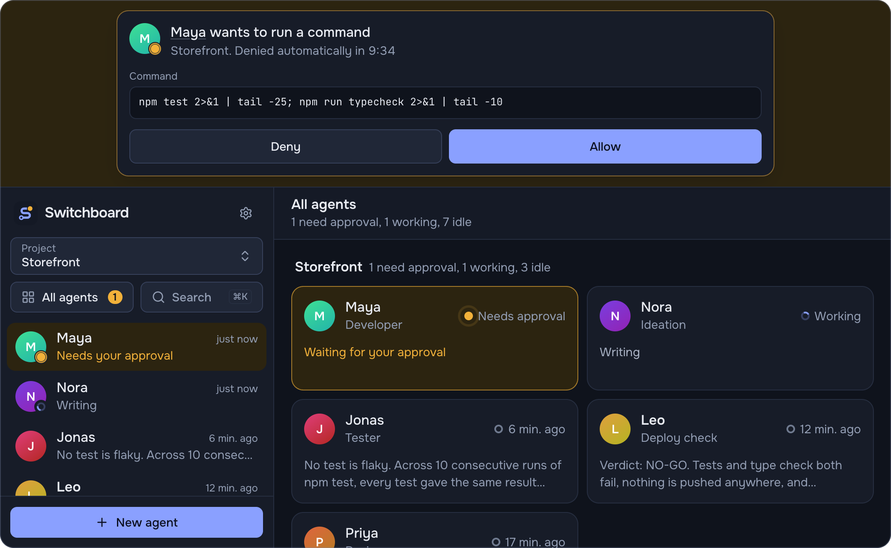
</p>

If Claude Code itself wants to ask about a call, for example a read through a symlink that leaves the project, that question always reaches you too. Inline shell commands inside skills are switched off, so a skill cannot run anything behind the gate.

For Edit, Write and NotebookEdit you can choose "Allow all edits inside the project for this turn". The host then lets further calls of that tool pass for files inside the project folders until the agent finishes the current turn. It never covers `.claude`, `.git`, `.mcp.json`, Switchboard's own folder or anything outside the project. Those still ask.

A waiting request shows up on every connected device. The first answer wins. Without an answer it is denied after 10 minutes. Stopping an agent denies its open requests.

## Working with agents

- Send a message while an agent is busy and it is queued, up to 20 messages per agent. It goes out when the current turn ends. Remove a queued message with the cross next to it. Stopping an agent drops its queue.
- The microphone button dictates into the message field. Browsers only allow this on a secure address such as localhost, so on the iPhone use the keyboard's microphone key or the native app. Pick the dictation language under Settings.
- Command K opens a search over all agents, projects and actions. Command period stops the open agent.
- Settings also holds the theme, browser notifications and a QR code that signs your phone in.
- Delete an agent from the menu in its chat header. Its conversation is removed, files it changed stay.

## Use it from your iPhone

1. Install Tailscale on the Mac and on the iPhone and sign in to the same account on both.
2. Start Switchboard on the Mac with `pnpm dev`. The log shows a second line such as `Switchboard listening on http://100.x.y.z:4317`. If it is missing, start Tailscale and restart Switchboard.
3. On the Mac, open Settings in the web app and scan the QR code with the iPhone camera. It opens Switchboard in Safari, already signed in.

Without the QR code, open the `100.x.y.z` address in Safari on the phone and paste the access token once. Or send yourself this link from the Mac, by AirDrop or Notes, and open it on the phone. The token part after `#` never leaves the browser:

```
http://100.x.y.z:4317/#token=YOUR_TOKEN
```

Find your Tailscale address with:

```bash
/Applications/Tailscale.app/Contents/MacOS/Tailscale ip -4
```

The Mac must be awake and Switchboard must be running. Nothing is reachable from outside your tailnet.

## Install it as an app

On the iPhone: open Switchboard in Safari, tap Share, then "Add to Home Screen". It opens full screen from the home screen icon.

On the Mac: in Chrome or Edge use "Install Switchboard" in the address bar. In Safari use File, then "Add to Dock".

An installed app can keep its own storage, apart from the browser you installed it from. If it asks for the access token, paste it once more. On the iPhone, copy the token on the Mac and paste it with Universal Clipboard.

Switchboard has no service worker, so it always needs the host to be reachable. If iOS should ever require HTTPS for home screen apps, let Tailscale serve it with a certificate and open the `https://` address it prints:

```bash
/Applications/Tailscale.app/Contents/MacOS/Tailscale serve --bg 4317
```

## Native apps

The folder `apple/` holds a Mac app and an iPhone app, written in SwiftUI from one codebase. They do what the web app does and add what a browser cannot:

- **Mac.** A menu bar item that lists waiting approvals and all agents, notifications with Allow and Deny buttons, and a first-run setup. The downloaded app starts its own built-in host. If you point it at a clone instead, it runs the host from there after the first `pnpm install`; for that, `node` and `pnpm` have to be in `/opt/homebrew/bin` or `/usr/local/bin`.
- **iPhone.** Pairing by scanning a QR code on the Mac, an approvals tray at the bottom of every screen, dictation on the device, and the token in the Keychain.

The Mac app is a [download](#install-the-mac-app). The iPhone app has no download yet: you build it from source with Xcode 26 and XcodeGen and sign it with your own Apple ID. Build steps, packaging the disk image, pairing, permissions and troubleshooting are in [apple/README.md](apple/README.md). To build the Mac app yourself:

```bash
cd apple
xcodegen generate
xcodebuild -project Switchboard.xcodeproj -scheme "Switchboard macOS" -configuration Release -derivedDataPath build build
ditto build/Build/Products/Release/Switchboard.app /Applications/Switchboard.app
open /Applications/Switchboard.app
```

## Scripts

| Command | What it does |
|---|---|
| `pnpm dev` | Host with restart on change, web build in watch mode |
| `pnpm start` | Build the web app once and start the host |
| `pnpm build` | Build the web app into `web/dist` |
| `pnpm typecheck` | Strict TypeScript check of all packages |
| `pnpm test` | Host tests: approval policy, approval broker, message translation, live state |
| `pnpm --filter @switchboard/web dev:hmr` | Vite dev server with hot reload on port 5173, proxied to a running host |
| `apple/Scripts/test.sh` | Tests of the native apps, see [apple/README.md](apple/README.md) |

## Data

- `data.nosync/switchboard.db` holds agents and messages (SQLite). To start from zero, stop the host and delete the files in `data.nosync/`. The `.nosync` ending keeps iCloud Drive from syncing the live database when the repo sits in a synced folder such as Desktop or Documents.
- `.env` and `projects.json` are yours. Git ignores both.
- Conversation transcripts are kept by Claude Code under `~/.claude/projects/`. Claude Code removes transcripts older than 30 days by default. An agent whose transcript is gone starts a new session on the next message and keeps its visible history.

## Troubleshooting

| Problem | Fix |
|---|---|
| "The host did not accept that token" | Copy the current value from `.env` again. Paste only the part after `SWITCHBOARD_TOKEN=`. |
| The app shows no project | Every entry in `projects.json` points at a folder that does not exist. The host log names them. Fix the paths and restart. |
| "The web app is still building" | The first build takes a few seconds after `pnpm dev`. Reload. |
| Phone cannot open the address | Check that Tailscale is connected on both devices and that the host log shows the `100.x.y.z` line. |
| An agent answers slowly after it finished typing | Global Stop hooks from `~/.claude` run after each turn. Use `SWITCHBOARD_SETTING_SOURCES=project,local`. |
| Agent shows "Error" after a restart | Send it a message. It resumes its session, or starts a new one if the transcript is gone. |
| An agent answers "Project ... is missing from projects.json" | Its project was removed or skipped because a folder is missing. Restore the entry with the same `id`. |
| Port 4317 is in use | Another Switchboard is running, or set `SWITCHBOARD_PORT`. |

## Not included

Background or scheduled agents, email or LinkedIn integrations, publishing to social networks, multiple users and cloud hosting.

## Status

Switchboard is a personal project by [Alex Platret](https://github.com/platret), built for one person.

- There is no licence yet. Until one is chosen, the code is public to read, and the usual rights to reuse it are not granted.
- The native apps are not notarized and not on the App Store. The Mac app is a download signed ad hoc, so macOS stops its first launch and asks for its permissions again after every update or rebuild. The iPhone app you build from source.
- So far the iPhone app has been tested in the simulator.
- One user, one Mac, one token. There are no accounts and no roles for people.
- There is no promise of support or of a stable API.

## Credits

- Agents run on the Claude Agent SDK, used under Anthropic's terms. It needs your own Claude Code login.
- The web components in `web/src/components/ui` come from shadcn/ui (MIT).
- Fonts: Onest and JetBrains Mono (SIL Open Font License 1.1), installed from npm at build time.
- Icons: lucide (ISC).
