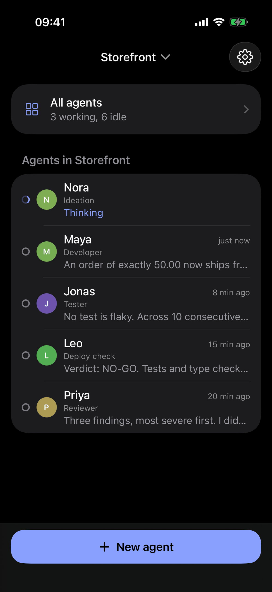
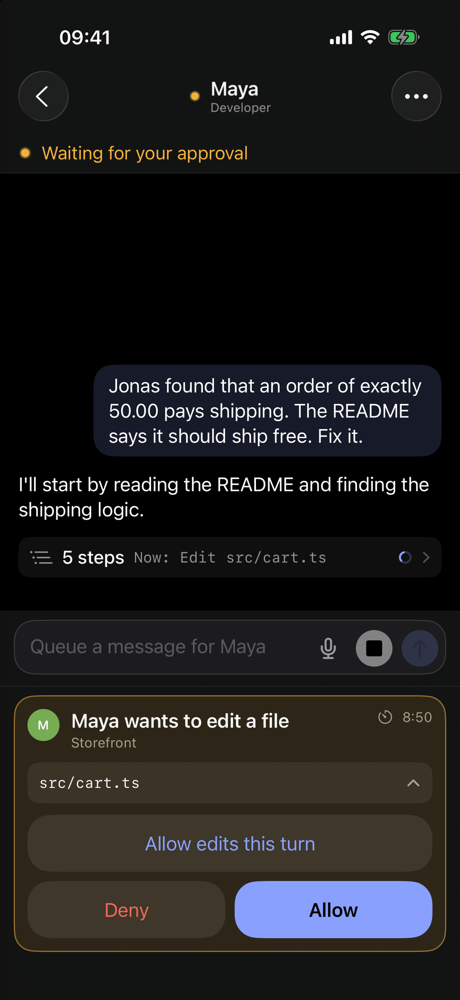
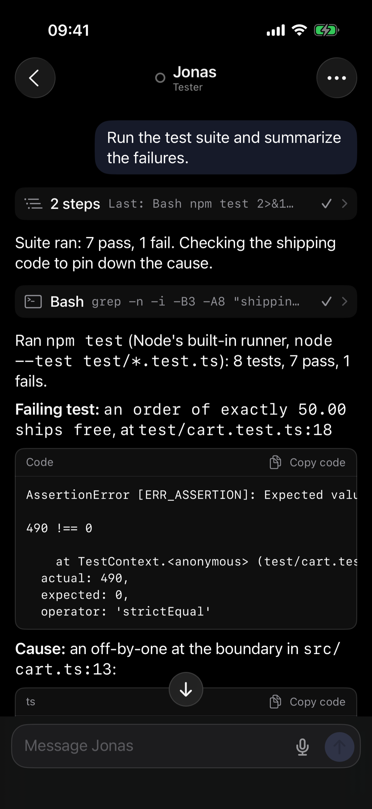

# Switchboard for Mac and iPhone

Two native SwiftUI apps that talk to the Switchboard host over the same WebSocket and REST API as the web app. Both are built from one codebase and one Xcode project. What Switchboard is and how to set up the host is in the [README one folder up](../README.md).

<table>
  <tr>
    <td width="33%"></td>
    <td width="33%"></td>
    <td width="33%"></td>
  </tr>
  <tr>
    <td align="center"><sub>Home with status lamps</sub></td>
    <td align="center"><sub>The approvals tray</sub></td>
    <td align="center"><sub>Chat with tool steps and code blocks</sub></td>
  </tr>
</table>

The screenshots come from the iPhone simulator and show demo data.

## What each app does

Both apps:

- Switch between projects and list the agents of the selected project. Each agent is a line with a status lamp: a hollow grey ring is idle, a cobalt ring with a turning arc is working, an amber dot with a pulsing ring waits for your approval, a red square stopped with an error.
- Create, rename and delete agents. Creating an agent lets you pick a role and shows what the role does.
- Chat with an agent: history, live streaming, markdown with code blocks and a copy button, tool calls that expand to show input and result.
- Keep typing while an agent works. The host queues those messages and the app shows them as chips you can remove. A stop button ends the current turn.
- Dictate a message with the microphone button. Speech is recognized on the device when the language supports it. Dictation stops as soon as you type, so typed text is never overwritten, and it stops by itself when a call or a change of microphone interrupts it.
- Show every pending approval, with what the agent wants to do, a countdown to the automatic denial, Deny and Allow, and for file edits a third choice that allows edits in the project for the rest of the turn. Long content can be expanded in full and copied.
- Guard approvals against slips: the buttons pause for a moment whenever the list of approvals changes, so a double click cannot answer the next request, and an answer is sent again after a reconnect until the host confirms it.
- List all agents across projects, sorted by urgency.
- Post a local notification when an approval arrives or an agent finishes while the app is not in front. The approval notification has Allow and Deny buttons.

Switchboard for Mac also:

- Has one main window (sidebar with the project picker and agents, chat on the right, an approvals panel whenever something waits) and a menu bar item that lists approvals and agents. A click on an agent there opens the main window on it. The menu bar icon changes while agents work and shows a count while approvals wait.
- Starts the host by itself (`pnpm start` in the repo folder) once `pnpm install` has run in the repo, and shows the last 200 lines of its output in Settings, Host. It never starts a second host when one already answers on the port.
- Shows a QR code to pair an iPhone (sidebar footer, File menu or menu bar item).
- Can open at login (Settings, General).
- Keyboard: Command N new agent, Command K find an agent, Command period stop, Shift Command A all agents, Command 1 to 9 open an agent of the project, Command D dictate, Return sends and Shift Return starts a new line.

Switchboard for iPhone also:

- Pairs by scanning the QR code from the Mac app, by pasting the pairing link, or by typing the host address and token.
- Shows pending approvals in a tray at the bottom of every screen. Swipe sideways when several wait, tap the summary for the full detail. While the keyboard is open the tray shrinks to one line.

## Requirements

- Xcode 26 or newer
- XcodeGen (`brew install xcodegen`)
- The host from this repo, see the [README one folder up](../README.md)
- Tailscale on the Mac and the iPhone for the iPhone app

## Generate the project

The Xcode project is generated from `project.yml`. Run this after pulling changes or adding files:

```bash
cd apple
xcodegen generate
open Switchboard.xcodeproj
```

## Build and run the Mac app

Pick the scheme `Switchboard macOS` and press Run, or build and install from the terminal:

```bash
xcodebuild -project Switchboard.xcodeproj -scheme "Switchboard macOS" -configuration Release -derivedDataPath build build
ditto build/Build/Products/Release/Switchboard.app /Applications/Switchboard.app
open /Applications/Switchboard.app
```

Quit a running copy before you install a new one.

The Mac app connects to `http://127.0.0.1:4317`, reads `SWITCHBOARD_TOKEN` from the `.env` file in the repo folder and starts the host there. On the first launch it looks for your clone, a folder named `switchboard`, in a few usual places under your home folder: the home folder itself, `code`, `Developer`, `Projects`, `dev`, `src`, `repos`, `GitHub`, `Desktop`, `Desktop/Projects`, `Documents`, `Documents/Projects` and `Documents/GitHub`. If your clone is somewhere else or has another name, choose it once in Settings, Connection. The app remembers the folder.

How the app treats the host:

- A host that already runs is used as it is. The app shows "Started outside the app" and offers no stop button for it. Stop it where you started it.
- A host that Switchboard started is recognized again after the app crashed or was force quit, so the stop button comes back.
- With no host running, the app starts one when it opens. Turn that off in Settings, Host.
- A host the app started stops when you quit the app. The app asks first when agents are still working.
- Closing the main window keeps the app and its menu bar item alive.

## Build and run the iPhone app in the simulator

Pick the scheme `Switchboard iOS` and an iPhone simulator, then press Run. From the terminal:

```bash
xcodebuild -project Switchboard.xcodeproj -scheme "Switchboard iOS" -sdk iphonesimulator \
  -destination "generic/platform=iOS Simulator" -derivedDataPath build build
open -a Simulator
xcrun simctl install booted build/Build/Products/Debug-iphonesimulator/Switchboard.app
```

The build needs no particular simulator. `open -a Simulator` starts the simulator you used last, and `booted` stands for the one that is running, so wait for its home screen before you install. If none starts, pick an iPhone under File, Open Simulator.

Debug builds accept a host and token at launch, which saves typing in the simulator. The app stores both, so later launches need no variables:

```bash
SIMCTL_CHILD_SWITCHBOARD_HOST=http://127.0.0.1:4317 \
SIMCTL_CHILD_SWITCHBOARD_TOKEN="$(sed -n 's/^SWITCHBOARD_TOKEN=//p' ../.env)" \
xcrun simctl launch booted ch.platret.switchboard
```

The simulator has no camera. The scanner screen offers a paste button there: copy the pairing link in the Mac app and paste it.

## Put the app on a real iPhone

1. Open `apple/Switchboard.xcodeproj` in Xcode.
2. Select the project in the sidebar, then the target `Switchboard iOS`, then the tab Signing and Capabilities.
3. Pick your team. A free Apple ID works. Add it under Xcode, Settings, Accounts if it is not listed.
4. Give the app your own bundle identifier, because an identifier can only be registered by one team. In `project.yml` change `bundleIdPrefix` and the three `PRODUCT_BUNDLE_IDENTIFIER` values to your own reverse domain, run `xcodegen generate`, and use your identifier in the `simctl launch` command above.
5. Connect the iPhone with a cable, unlock it and choose Trust if it asks. Select it as the run destination at the top of the window.
6. Press Run.
7. The first time, iOS refuses to open the app until you trust yourself as a developer: on the iPhone open Settings, General, VPN and Device Management, tap your Apple ID and choose Trust. Newer iOS versions also ask you to turn on Developer Mode under Settings, Privacy and Security, which needs a restart.

Builds signed with a free Apple ID expire after 7 days. Press Run again to renew the app. Your pairing stays on the phone.

`xcodegen generate` resets the team. To keep it, add `DEVELOPMENT_TEAM: YOURTEAMID` to the settings of `Switchboard iOS` in `project.yml`.

## Pairing

1. Make sure Tailscale is connected on the Mac and on the iPhone, with the same account.
2. In the Mac app choose Pair iPhone. The sheet shows a QR code and the Tailscale address of the Mac. Correct the address if it is wrong.
3. On the iPhone open Switchboard, choose "Scan the code on your Mac" and point the camera at the code.

The code is the plain link `http://TAILSCALE_IP:4317/#token=TOKEN`. That is the same link the web app accepts, so the iPhone camera app can open it in Safari to use the web app instead. Anyone who sees the code can reach your host from inside your tailnet, so do not share a screenshot of it.

Without a camera, copy the link in the pairing sheet and paste it into the scanner screen, or into the host address field under "Enter the address by hand". The iPhone keeps the token in the Keychain. "Forget this host" in the iPhone settings removes it.

## Permissions the apps ask for

| Permission | App | Why |
|---|---|---|
| Files in your Desktop or Documents folder | Mac | Asked when your clone lies there, or while the app looks for it on the first launch. The app reads the token from `.env` in the clone and starts the host in that folder. |
| Notifications | both | Approvals and finished agents while the app is not in front. |
| Microphone and speech recognition | both | Dictation. Asked the first time you tap the microphone. |
| Camera | iPhone | Scanning the pairing code. |
| Local network | iPhone | iOS may ask before the first connection to the Mac. |

The Mac app is signed ad hoc, without a developer team, and is not sandboxed. macOS ties permissions to that signature, so it asks again after every rebuild.

## Tests

```bash
Scripts/test.sh
```

The script runs the unit tests and the tests against the live host on `127.0.0.1:4317`. It reads the token from `.env` in the repo and hands it to the test runner, because macOS may not let the test runner read a clone under Desktop or Documents by itself. Without a running host all live tests are skipped. Running `xcodebuild test` directly works too and skips the two tests that need the token when the runner cannot read `.env`. The tests never start or stop a host. Build products go to `build/tests`, set `SWITCHBOARD_DERIVED_DATA` to use another folder.

## Troubleshooting

**The Mac app stays on Connecting.** If your clone is under Desktop, Documents or Downloads, macOS is showing "Switchboard would like to access files in your Desktop folder" or the same for the other folder. Choose Allow. If the prompt is gone, turn the access on under System Settings, Privacy and Security, Files and Folders, Switchboard. Without it the app cannot read the token. You can still type the host address and token in Settings, Connection.

**The Mac app says "Choose the folder of your Switchboard clone".** The app did not find your clone by itself. Open Settings, Connection, press Choose in the section Repo folder and pick the folder that holds `package.json` and `host`. Then press Start host.

**The Mac app says Token rejected.** The token in the Keychain or in `.env` is not the one the running host uses. Check `SWITCHBOARD_TOKEN` in `.env`, restart the host if you changed it, then press Connect in Settings, Connection.

**The Mac app does not start the host.** Open Settings, Host and read the log. The app runs `pnpm start` with `/opt/homebrew/bin:/usr/local/bin:/usr/bin:/bin:/usr/sbin:/sbin` as its path, so `pnpm` and `node` have to be in one of those folders. Run `pnpm install` in the repo once before the first start.

**An agent answers "Can't read the current directory (EINTR)".** The Claude process behind the agent was not allowed to read the project folder. This happens for projects under Desktop, Documents or Downloads when the program that started the host has no access to that folder, or while a macOS permission prompt is waiting unanswered on the Mac. Answer the prompts on the Mac, then stop the host and start it again from the Mac app or from a terminal that may read those folders. Moving the project out of those folders avoids it for good.

**macOS asks about Documents or Downloads.** When the Mac app started the host, file access by agents counts as access by Switchboard. Allow it for the folders your projects use.

**The iPhone does not connect.** Check that Tailscale is connected on both devices and that the host printed a line with the Tailscale address when it started. The host listens on `127.0.0.1` and the Tailscale address only, not on the Wi-Fi address. Open the pairing link in Safari on the iPhone: if the web app loads, pair again in the app.

**Notifications do not arrive on the iPhone.** There is no push server. Notifications work while the app is open or was sent to the background moments ago. iOS suspends the connection after that, and the app reconnects when you open it.

**Dictation says it is not available.** Allow the microphone and speech recognition for Switchboard in the system settings, and pick a language that your device supports in the dictation section of the app settings.

**The iPhone app no longer opens after a week.** The free signing certificate expired. Connect the phone and press Run in Xcode again.

**Xcode cannot find a file after pulling changes.** Run `xcodegen generate` again.

## Layout

| Folder | Contents |
|---|---|
| `Shared/Core` | Models, WebSocket and REST client, the app store, Keychain, settings, markdown parsing, dictation, notifications, pairing links |
| `Shared/Views` | SwiftUI views used by both apps |
| `macOS` | Mac app entry, main window, menu bar item, host control, settings |
| `iOS` | iPhone app entry, navigation, approvals tray, QR scanner, settings |
| `Tests` | Unit tests and live host tests |
| `Scripts` | `make-icons.mjs` draws the app icon, `test.sh` runs the tests, `make-dmg.sh` builds the disk image (with `bundle-host.mjs` and `host-deps.mjs`) |
| `Packaging` | The disk image window: background art and `dmg-settings.py` |

## Packaging

`Scripts/make-dmg.sh` builds a Switchboard.app that carries its own host, Node.js and Claude, and packs it into a disk image with the usual drag-to-Applications window. Whoever installs it needs no clone, no Node and no pnpm.

```bash
apple/Scripts/make-dmg.sh
```

It prints the paths and sizes at the end. The image is `apple/build/Switchboard-<version>-arm64.dmg`, with the version taken from `MARKETING_VERSION` in `project.yml`. Everything it builds stays in `apple/build`, which git ignores. Downloads are cached in `~/Library/Caches/switchboard-build`, so later runs work from the cache. Run it again after any change; it starts from a clean stage each time.

It needs Xcode, XcodeGen, pnpm with `pnpm install` done in the repo, and [uv](https://docs.astral.sh/uv/) for `uvx`. It builds for Apple silicon only.

What the script does:

1. Downloads the official Node.js 24 LTS for darwin-arm64 from nodejs.org and checks it against the SHA-256 in that release's `SHASUMS256.txt`. The version is pinned at the top of the script. Homebrew's node cannot ship in an app because it links against other Homebrew libraries.
2. Builds the web app and bundles the host code (`host/src/index.ts`, `@switchboard/shared`, Express and ws) into one file with the esbuild that comes with tsx (`Scripts/bundle-host.mjs`). The bundle also gets a `THIRD-PARTY-NOTICES.txt` with the licences of what went into it.
3. Installs the packages the bundle keeps outside with the downloaded node's npm: `@anthropic-ai/claude-agent-sdk` with its darwin-arm64 claude binary, `better-sqlite3` and `zod`. `Scripts/host-deps.mjs` pins them, and everything they pull in, to the versions in `pnpm-lock.yaml`. The tree is flat and has no symlinks. better-sqlite3 13 ships Node-API prebuilds, which work with any Node version; only the darwin-arm64 one is kept. No install scripts run.
4. Checks that better-sqlite3 and the Agent SDK load with the bundled node and that `claude --version` runs.
5. Builds the `Switchboard macOS` scheme in Release for arm64, copies the host into the app and signs it from the inside out.
6. Makes the disk image with [dmgbuild](https://github.com/dmgbuild/dmgbuild) (pinned, run through `uvx`). Without uvx, or when dmgbuild fails, it falls back to `hdiutil` with a plain window and says so.
7. Mounts the image read-only and checks that it holds the app and the Applications link and that the app's signature still verifies.

The host inside the app:

| Path in `Switchboard.app/Contents/Resources` | What it is |
|---|---|
| `Host/start` | Starts the host. Switchboard runs it with `SWITCHBOARD_HOME` set and that folder as the working directory. It `exec`s node, so stopping the process stops the host. |
| `Host/node` | Node.js 24 LTS from nodejs.org |
| `Host/claude` | Link to the Agent SDK's claude binary in `app/node_modules` |
| `Host/app` | The host's root folder: `host/dist/index.mjs`, `web/dist`, `roles.json`, `projects.example.json`, `node_modules` |

The packaged host keeps its settings, token, `projects.json` and database in `~/Library/Application Support/Switchboard` (the `SWITCHBOARD_HOME` folder, see the [README one folder up](../README.md)). A host started from a clone keeps working as before.

To try the bundled host without the app (use a free port, not the one your own host runs on):

```bash
home=$(mktemp -d)
printf 'SWITCHBOARD_PORT=4392\n' > "$home/.env"
SWITCHBOARD_HOME="$home" apple/build/dist/Switchboard.app/Contents/Resources/Host/start
```

**Signing.** There is no Developer ID here, so the app is signed ad hoc and not notarized. The script signs each Mach-O file in `Host` before the app itself: unsigned files (the better-sqlite3 addon) ad hoc, while `node` and `claude` keep the Developer ID signatures that the Node.js project and Anthropic notarized them with. Pass `--adhoc-all` to sign those two ad hoc as well. It ends with `codesign --verify --deep --strict`. Because the app is not notarized, macOS refuses to open it the first time it is downloaded: Control-click the app in Applications and choose Open, or allow it under System Settings, Privacy and Security. Copies built on your own Mac open without that.

**Window art.** `Packaging/dmg-background.html` is the source of the image window background. `Packaging/render-background.mjs` renders it with headless Chrome to `dmg-background.png`, `dmg-background@2x.png` and the Retina `dmg-background.tiff` that dmgbuild uses. The rendered files are committed, so building the image needs no Chrome. After changing the art, render it again and keep the icon positions in `Packaging/dmg-settings.py` on the two slots, which are centred at (170, 190) and (490, 190) in the 660 by 420 window:

```bash
node apple/Packaging/render-background.mjs path/to/folder/with/puppeteer-core
```

## App icon

```bash
node Scripts/make-icons.mjs
```

This redraws every icon size in `Shared/Assets.xcassets/AppIcon.appiconset` from the same art as the web app icon.

## Limits

- The iPhone app has no push server, see Troubleshooting.
- The host speaks plain HTTP inside your tailnet, so both apps allow connections without HTTPS.
- Unsent text in the message field is kept per agent until the app quits.
- The Mac sidebar is not reachable with the arrow keys. Use Command 1 to 9 or Command K.
